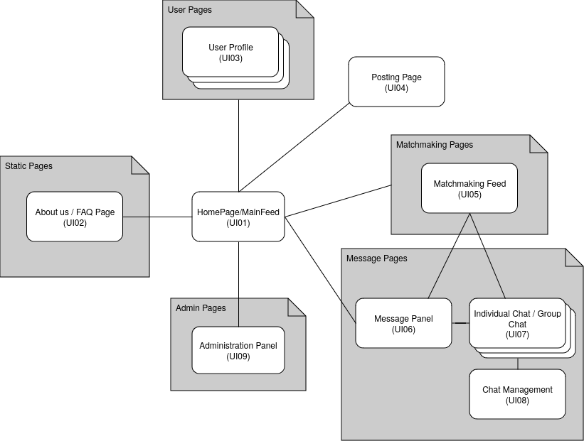

# LBAW

# ER: Requirements Specification Component

> Project vision.

## A1 - ConnectFEUP

The project aims to develop a social networking platform specifically designed for students at FEUP, addressing the common challenge of making real connections in a large university setting. The motivation behind this initiative stems from the need for a safe and trustworthy space where students can form friendships and romantic relationships, particularly benefiting those who may be shy or introverted. This platform will help students meet like-minded peers, fostering meaningful and unique connections.

The primary mission of the platform is to facilitate relationships among students, whether personal, romantic, or professional. A crucial aspect of this project is ensuring that only verified FEUP students can access the platform, thereby safeguarding personal data and maintaining user privacy. With an intuitive, user-friendly interface, the platform will incorporate Tinder-like functionalities, ensuring it is fully compatible across all devices, such as desktops, tablets, and smartphones.

To achieve this, the platform will provide a variety of features for users. It will allow new users to register easily with their FEUP credentials, sign in and out, and recover lost passwords. Users will have the ability to view public profiles, edit their personal information, and even delete their accounts if they choose to leave the platform.

Once authenticated, users will gain access to a host of additional features. They will be able to view and edit their profiles, change their profile pictures, and check personal notifications. A personalized timeline will showcase updates based on friends' activities, while robust search functionalities will help users find posts, comments, groups, and other users, enhanced by customizable search filters.

Furthermore, users will have the ability to send and manage friend requests, view friend profiles, and create and interact with posts. They can comment on, like, and reply to posts, as well as create groups, join public groups, and tag friends in their posts. They will also have the option to view their friends' feeds and ask to join public groups.

For those who create content, features will include the ability to edit and delete their posts, as well as manage post visibility. Comment authors will also have the ability to edit or delete their comments. Group members will be able to view other members, post in groups, and leave groups when they wish, while group owners will have additional privileges, such as editing group information, managing membership requests, and removing members or posts from the group.

Notifications will keep users informed about likes on their posts, comments on their content, and incoming friend requests, ensuring they remain engaged with their network. Administrators will play a vital role in managing user accounts, including locking, unlocking, and deleting accounts as needed.

To assist users, the platform will feature contextual help, bookmarks for form entries, and error messages to enhance user experience. Additionally, the site will provide information about itself, including an "About Us" section, details about its main features, and contact information for support.

Overall, this social networking platform seeks to create a vibrant and secure environment for FEUP students, facilitating authentic connections and enriching their university experience.

## A2: Actors and User stories

The _actors_ and _user stories_ contain information about the people who will use ConnectFEUP and how to use it.  

### 1. Actors

In the figure below, you can see the representation of the actors

{style="display: block; margin: 0 auto" }

Below, you can see the description of each actor

| Identifier              | Name      |                                     
| ----------------------- | --------- | 
|  Administrator          | Administrator The administrator has the power to remove messages, block and unblock people. |
|  User                   | Normal User. |
|  Guest                  | Unauthenticated users can view public information, register or log in. |
|  Autenticated User      | Authenticated users can view information, comment on other people's posts, send and receive messages with other people or groups. |
|  Group Member           | Members of a group can participate, chat and post in a group, but do not have special permissions. |
|  Group Owner            | Group owners not only have the same permissions as a member, but can also edit the group name, description, add/remove members and edit the permissions of other participants. |
|  Post Author            | Users can delete or edit their post. |
|  Comment Author         | Users can edit or delete their own comments on any post. |

### 2. User Stories

> User stories organized by actor.  
> For each actor, a table containing a line for each user story, and for each user story: an identifier, a name, a priority, and a description (following the recommended pattern).
> Below is a template for presenting the user stories.

#### 2.1. Administer

- **Administer**: Manages user accounts, blocks or unblocks users, and ensures safe platform use.

| Identifier   | Name                   | Priority    | Description                                                             |
| ------------ | ---------------------- | ----------- | ----------------------------------------------------------------------- |
|  US01        | Block User              | High        | Block users to prevent abusive behavior.                                 |
|  US02        | Unblock User            | Medium      | Unblock users who were previously blocked to restore their access.       |
|  US03        | Delete User Account     | Medium      | Delete user accounts to remove inactive or inappropriate users.          |
|  US04        | Manage User Roles       | High        | Assign or change user roles (e.g., promote to moderator) to manage permissions. |
|  US05        | View User Activity Logs | Medium      | View activity logs of users to monitor behavior and ensure compliance.   |
|  US06        | Suspend User Account    | High        | Temporarily suspend user accounts for misconduct without permanent deletion. |
|  US07        | Restore User Account    | Low         | Restore previously suspended or deleted user accounts.                   |
|  US08        | Manage Content          | Medium      | Remove inappropriate or flagged content to maintain platform safety.     |
|  US09        | Broadcast Announcement  | Low         | Send global announcements to all users for important updates or news.    |
|  US10        | Manage Reports          | High        | Review and resolve reports made by users regarding inappropriate behavior or content. |

#### 2.2. User

- **User**: Manages personal profile information and account settings.

| Identifier   | Name               | Priority    | Description                                                           |
| ------------ | ------------------ | ----------- | --------------------------------------------------------------------- |
|  US01        | Edit Profile        | High        | Edit personal profile information to keep it accurate and up to date.  |
|  US02        | Change Password     | Medium      | Change the account password to enhance account security.               |
|  US03        | Delete Account      | Low         | Delete the account to permanently remove personal data from the platform. |
|  US04        | Update Profile Picture | Medium   | Update the profile picture to reflect a new image.                     |
|  US05        | Set Profile Visibility | Medium   | Set the profile's visibility to public or private to control who sees the information. |
|  US06        | Recover Password    | High        | Recover a lost or forgotten password to regain access to the account.  |
|  US07        | Manage Notifications | Medium     | Manage notification preferences to control which alerts are received.  |

### 2.3 Visitor

- **Visitor**: Browses public information, registers, and logs in.

| Identifier   | Name                  | Priority    | Description                                                         |
| ------------ | --------------------- | ----------- | ------------------------------------------------------------------- |
|  US01        | Register Account       | High        | Register a new account to access platform features.                  |
|  US02        | Log In                 | High        | Log in to an existing account to access personalized features.       |
|  US03        | Browse Public Profiles | Medium      | Browse public profiles to explore users before registering or logging in. |
|  US04        | Recover Password       | Medium      | Recover a lost or forgotten password to regain access to the account. |
|  US05        | View About Page        | Low         | View information about the platform, such as mission and goals.      |
|  US06        | View Contact Page      | Low         | View contact information to reach out to platform administrators.    |

#### 2.4. Authenticated

- **Authenticated User**: Has access to features like posting, commenting, managing friends, and joining groups.

| Identifier   | Name               | Priority    | Description                                                             |
| ------------ | ------------------ | ----------- | ----------------------------------------------------------------------- |
|  US01        | Create Post         | High        | Create a post to share content with other users.                         |
|  US02        | Comment on Post     | High        | Comment on a post to engage in discussions with other users.             |
|  US03        | Send Friend Request | Medium      | Send a friend request to connect with other users.                       |
|  US04        | Join Group          | Medium      | Join a group to interact with like-minded users.                         |
|  US05        | Like Post           | Low         | Like a post to show appreciation or agreement.                           |
|  US06        | Manage Friend List  | Medium      | Manage the list of friends by adding or removing users.                  |
|  US07        | View Notifications  | Medium      | View notifications to stay updated on interactions related to your posts or profile. |
|  US08        | Edit Group Post     | Low         | Edit posts within a group to update or correct information.              |

### 2.5 Group Member

- **Group Member**: Interacts within groups by posting and engaging with other group members.

| Identifier   | Name                 | Priority    | Description                                                             |
| ------------ | -------------------- | ----------- | ----------------------------------------------------------------------- |
|  US01        | Create Group Post     | High        | Create a post within a group to share content with other group members.  |
|  US02        | Comment on Group Post | Medium      | Comment on a group post to engage in discussions with other members.     |
|  US03        | Like Group Post       | Low         | Like a post in a group to show appreciation or agreement with the content. |
|  US04        | View Group Members    | Medium      | View the list of group members to know who is part of the group.         |
|  US05        | Leave Group           | Low         | Leave the group to stop participating and receiving group notifications. |

### 2.6 Proprietário do grupo

- **Group Owner**: Manages group settings and membership, controls group visibility.

| Identifier   | Name                 | Priority    | Description                                                             |
| ------------ | -------------------- | ----------- | ----------------------------------------------------------------------- |
|  US01        | Edit Group Details    | High        | Edit group details such as name, description, and visibility settings.   |
|  US02        | Add/Remove Members    | High        | Add or remove group members to control group participation.              |
|  US03        | Approve Join Requests | Medium      | Approve or reject requests from users who want to join the group.        |
|  US04        | Remove Group Post     | Medium      | Remove inappropriate or unwanted posts from the group.                   |
|  US05        | Change Group Privacy  | Low         | Change the group’s privacy settings to make it public or private.        |
|  US06        | Invite Members        | Medium      | Invite new members to join the group via direct invitation.              |
|  US07        | Manage Group Roles    | Low         | Assign roles within the group, such as promoting a member to moderator.  |

### 2.7 Post Author

- **Post Author**: Edits or deletes their own posts.

| Identifier   | Name                 | Priority    | Description                                                             |
| ------------ | -------------------- | ----------- | ----------------------------------------------------------------------- |
|  US01        | Edit Post             | High        | Edit a post to correct or update the content after publishing.           |
|  US02        | Delete Post           | High        | Delete a post to remove it permanently from the platform.                |
|  US03        | Manage Post Visibility| Medium      | Manage the visibility of a post by making it public, private, or restricted to certain users. |
|  US04        | Tag Friends in Post   | Medium      | Tag friends in a post to notify and include them in the shared content.  |
|  US05        | Add Media to Post     | Low         | Add images or videos to a post to enhance the content.                   |

### 2.8 Comment Author

- **Comment Author**: Edits or deletes their own comments.

| Identifier   | Name               | Priority    | Description                                                             |
| ------------ | ------------------ | ----------- | ----------------------------------------------------------------------- |
|  US01        | Edit Comment        | High        | Edit a comment to correct or update the content after posting.           |
|  US02        | Delete Comment      | High        | Delete a comment to remove it permanently from a post.                   |
|  US03        | Reply to Comment    | Medium      | Reply to a comment to engage in a conversation or clarify points.        |
|  US04        | Like Comment        | Low         | Like a comment to show agreement or appreciation.                        |
|  US05        | Tag Friends in Comment | Low      | Tag friends in a comment to bring them into the conversation.            |

### 3. Supplementary Requirements

> Section including business rules, technical requirements, and restrictions.  
> For each subsection, a table containing identifiers, names, and descriptions for each requirement.

#### 3.1. Business rules

#### 3.2. Technical requirements

#### 3.3. Restrictions

---

## A3: Information Architecture

> Brief presentation of the artifact goals.

### 1. Sitemap

{style="display: block; margin: 0 auto" }

### 2. Wireframes

> Wireframes for, at least, two main pages of the web application.
> Do not include trivial use cases (e.g. about page, contacts).

#### UIxx: Page Name

#### UIxx: Page Name

---

## Revision history

Changes made to the first submission:
1. Item 1
1. ...

***
GROUP24116, 01/10/2024

* Alexandre Chouzende - 202207429@up.pt
* Rui Borges - 202207475@up.pt
* Pedro Paixão- 202008467@up.pt
* Tiago Torrado - 202206399@up.pt