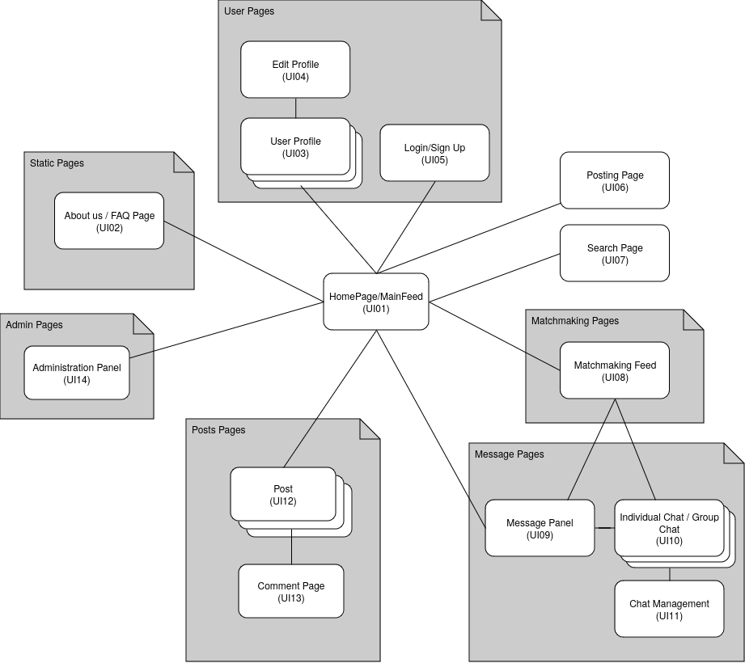
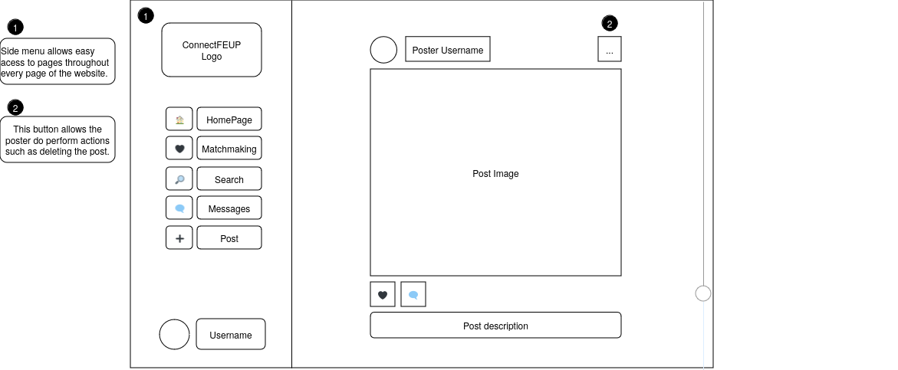
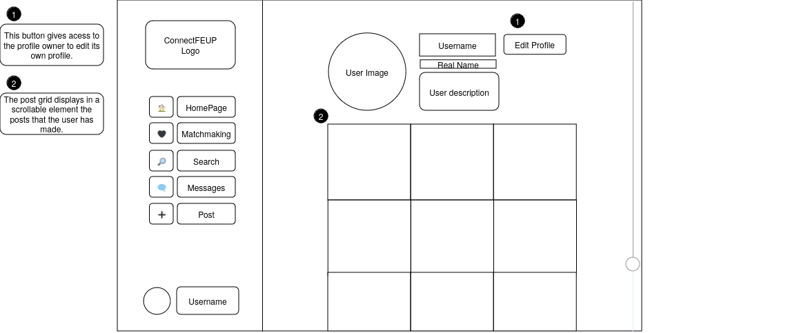
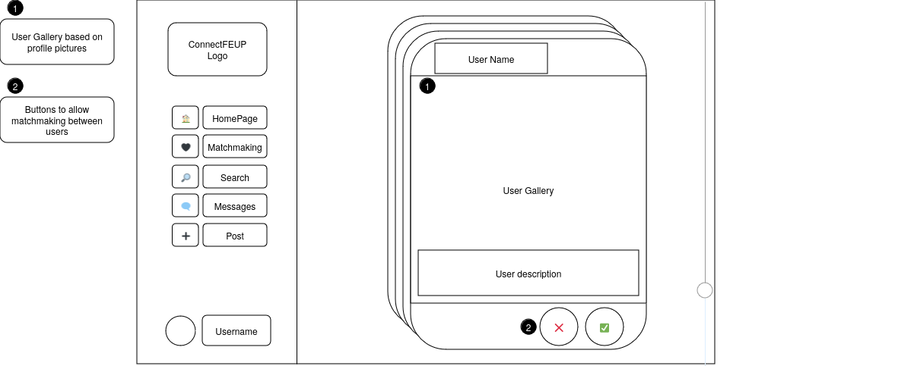

# LBAW

# ER: Requirements Specification Component

## A1 - ConnectFEUP

The project aims to develop a social networking platform specifically designed for students at FEUP, addressing the common challenge of making real connections in a large university setting. The motivation behind this initiative stems from the need for a safe and trustworthy space where students can form friendships and romantic relationships, particularly benefiting those who may be shy or introverted. This platform will help students meet like-minded peers, fostering meaningful and unique connections.

The primary mission of the platform is to facilitate relationships among students, whether personal, romantic, or professional. A crucial aspect of this project is ensuring that only verified FEUP students can access the platform, thereby safeguarding personal data and maintaining user privacy. With an intuitive, user-friendly interface, the platform will incorporate Tinder-like functionalities, ensuring it is fully compatible across all devices, such as desktops, tablets, and smartphones.

To achieve this, the platform will provide a variety of features for users. It will allow new users to register easily with their FEUP credentials, sign in and out, and recover lost passwords. Users will have the ability to view public profiles, edit their personal information, and even delete their accounts if they choose to leave the platform.

Once authenticated, users will gain access to a host of additional features. They will be able to view and edit their profiles, change their profile pictures, and check personal notifications. A personalized timeline will showcase updates based on friends' activities, while robust search functionalities will help users find posts, comments, groups, and other users, enhanced by customizable search filters.

Furthermore, users will have the ability to send and manage friend requests, view friend profiles, and create and interact with posts. They can comment on, like, and reply to posts, as well as create groups, join public groups, and tag friends in their posts. They will also have the option to view their friends' feeds and ask to join public groups.

For those who create content, features will include the ability to edit and delete their posts, as well as manage post visibility. Comment authors will also have the ability to edit or delete their comments. Group members will be able to view other members, post in groups, and leave groups when they wish, while group owners will have additional privileges, such as editing group information, managing membership requests, and removing members or posts from the group.

The main objective of this project is to facilitate meaningful connections among students from the same faculty, whether personal, romantic, or professional. A key priority is ensuring that only verified FEUP students can access the platform, safeguarding personal data and privacy. The platform will feature an intuitive, user-friendly interface, incorporating Tinder-like functionality, and will be fully compatible across all devices.

Notifications will keep users informed about likes on their posts, comments on their content, and incoming friend requests, ensuring they remain engaged with their network. Administrators will play a vital role in managing user accounts, including locking, unlocking, and deleting accounts as needed.

To assist users, the platform will feature contextual help, bookmarks for form entries, and error messages to enhance user experience. Additionally, the site will provide information about itself, including an "About Us" section, details about its main features, and contact information for support.

Overall, this social networking platform seeks to create a vibrant and secure environment for FEUP students, facilitating authentic connections and enriching their university experience.

## A2: Actors and User stories

The _actors_ and _user stories_ contain information about the people who will use ConnectFEUP and how to use it.  

### 1. Actors

In the figure below, you can see the representation of the actors

{style="display: block; margin: 0 auto" }

Below, you can see the description of each actor

| Identifier              | Name      |                                     
| ----------------------- | --------- | 
|  Administrator          | Administrator The administrator has the power to remove messages, block and unblock people. |
|  User                   | Normal User. |
|  Guest                  | Unauthenticated users can view public information, register or log in. |
|  Autenticated User      | Authenticated users can view information, comment on other people's posts, send and receive messages with other people or groups. |
|  Group Member           | Members of a group can participate, chat and post in a group, but do not have special permissions. |
|  Group Owner            | Group owners not only have the same permissions as a member, but can also edit the group name, description, add/remove members and edit the permissions of other participants. |
|  Post Author            | Users can delete or edit their post. |
|  Comment Author         | Users can edit or delete their own comments on any post. |

## 2. User Stories

#### 2.1. Administer

- **Administer**: Responsible for managing user accounts, blocking/unblocking users, overseeing platform content, and ensuring safety and compliance.

| Identifier   | Name                   | Priority    | Description                                                             |
| ------------ | ---------------------- | ----------- | ----------------------------------------------------------------------- |
|  US01        | Block User              | High        | The system must allow admins to block users to prevent abusive behavior. |
|  US02        | Unblock User            | Medium      | The system must allow admins to unblock users previously blocked to restore their access. |
|  US03        | Delete User Account     | Medium      | Admins must be able to permanently delete user accounts that are inactive or inappropriate. |
|  US04        | Manage User Roles       | High        | Admins should assign or change user roles (e.g., moderator) to manage permissions. |
|  US05        | View User Activity Logs | Medium      | Admins must have access to user activity logs to monitor behavior and ensure compliance with platform policies. |
|  US06        | Suspend User Account    | High        | Admins must be able to temporarily suspend user accounts for misconduct without deleting them. |
|  US07        | Restore User Account    | Low         | Admins must be able to restore previously suspended or deleted user accounts if necessary. |
|  US08        | Manage Content          | Medium      | Admins should be able to remove inappropriate or flagged content to maintain platform integrity. |
|  US09        | Broadcast Announcement  | Low         | Admins should be able to send platform-wide announcements for updates or important information. |
|  US10        | Manage Reports          | High        | Admins should be able to review and resolve user-submitted reports regarding misconduct or inappropriate content. |

---

#### 2.2. User

- **User**: Manages personal profile information, account settings, and preferences.

| Identifier   | Name                   | Priority    | Description                                                             |
| ------------ | ---------------------- | ----------- | ----------------------------------------------------------------------- |
|  US01        | Edit Profile            | High        | Users must be able to edit personal profile information to keep it up to date. |
|  US02        | Change Password         | Medium      | Users should be able to change their account password for enhanced security. |
|  US03        | Delete Account          | Low         | Users should have the option to delete their account and remove their data from the platform. |
|  US04        | Update Profile Picture  | Medium      | Users should be able to upload and change their profile picture. |
|  US05        | Set Profile Visibility  | Medium      | Users must be able to control their profile's visibility (public/private). |
|  US06        | Recover Password        | High        | Users should be able to recover a lost or forgotten password. |
|  US07        | Manage Notifications    | Medium      | Users should have the option to manage notification preferences. |

---

#### 2.3 Visitor

- **Visitor**: Browses public information, registers for an account, and logs in.

| Identifier   | Name                   | Priority    | Description                                                             |
| ------------ | ---------------------- | ----------- | ----------------------------------------------------------------------- |
|  US01        | Register Account        | High        | Visitors must be able to register a new account to access platform features. |
|  US02        | Log In                  | High        | Visitors must be able to log in to an existing account. |
|  US03        | Browse Public Profiles  | Medium      | Visitors should be able to browse public profiles before registering or logging in. |
|  US04        | Recover Password        | Medium      | Visitors must have the ability to recover a forgotten password. |
|  US05        | View About Page         | Low         | Visitors should be able to view an "About" page with information about the platform’s mission and goals. |
|  US06        | View Contact Page       | Low         | Visitors should be able to view contact information to reach out to platform administrators. |

---

#### 2.4. Authenticated

- **Authenticated User**: Gains access to posting, commenting, managing friends, and joining groups.

| Identifier   | Name                   | Priority    | Description                                                             |
| ------------ | ---------------------- | ----------- | ----------------------------------------------------------------------- |
|  US01        | Create Post             | High        | Authenticated users should be able to create posts to share content with other users. |
|  US02        | Comment on Post         | High        | Authenticated users must be able to comment on posts to participate in discussions. |
|  US03        | Send Friend Request     | Medium      | Authenticated users should be able to send friend requests to other users. |
|  US04        | Join Group              | Medium      | Authenticated users should be able to join groups to interact with like-minded people. |
|  US05        | Like Post               | Low         | Users should be able to like posts to show appreciation or agreement. |
|  US06        | Manage Friend List      | Medium      | Users must be able to manage their friends list by adding or removing friends. |
|  US07        | View Notifications      | Medium      | Users should be able to view notifications about interactions related to their profile and posts. |
|  US08        | Edit Group Post         | Low         | Users should be able to edit posts within a group. |

---

#### 2.5 Group Member

- **Group Member**: Participates in group interactions through posts and engagement.

| Identifier   | Name                   | Priority    | Description                                                             |
| ------------ | ---------------------- | ----------- | ----------------------------------------------------------------------- |
|  US01        | Create Group Post       | High        | Group members should be able to create posts within the group. |
|  US02        | Comment on Group Post   | Medium      | Group members must be able to comment on group posts to engage in group discussions. |
|  US03        | Like Group Post         | Low         | Group members should be able to like posts within the group. |
|  US04        | View Group Members      | Medium      | Group members should be able to view the list of other members. |
|  US05        | Leave Group             | Low         | Group members should be able to leave a group and stop receiving notifications. |

---

#### 2.6 Group Owner

- **Group Owner**: Manages group settings, membership, and controls visibility.

| Identifier   | Name                   | Priority    | Description                                                             |
| ------------ | ---------------------- | ----------- | ----------------------------------------------------------------------- |
|  US01        | Edit Group Details      | High        | Group owners should be able to edit the group’s name, description, and visibility settings. |
|  US02        | Add/Remove Members      | High        | Group owners must be able to add or remove members from the group. |
|  US03        | Approve Join Requests   | Medium      | Group owners should be able to approve or reject membership requests. |
|  US04        | Remove Group Post       | Medium      | Group owners should be able to remove inappropriate posts from the group. |
|  US05        | Change Group Privacy    | Low         | Group owners must be able to change the group’s privacy settings (public/private). |
|  US06        | Invite Members          | Medium      | Group owners should be able to invite new members directly to join the group. |
|  US07        | Manage Group Roles      | Low         | Group owners should be able to assign roles within the group, such as promoting members to moderators. |

---

#### 2.7 Post Author

- **Post Author**: Controls the content of their own posts, with options to edit or delete them.

| Identifier   | Name                   | Priority    | Description                                                             |
| ------------ | ---------------------- | ----------- | ----------------------------------------------------------------------- |
|  US01        | Edit Post               | High        | Post authors must be able to edit their posts to correct or update information. |
|  US02        | Delete Post             | High        | Post authors must be able to delete their posts permanently. |
|  US03        | Manage Post Visibility  | Medium      | Post authors must be able to control the visibility of their posts (public, private, or restricted). |
|  US04        | Tag Friends in Post     | Medium      | Post authors should be able to tag friends in their posts. |
|  US05        | Add Media to Post       | Low         | Post authors should be able to add media (images, videos) to their posts. |

---

#### 2.8 Comment Author

- **Comment Author**: Edits or deletes their own comments.

| Identifier   | Name                   | Priority    | Description                                                             |
| ------------ | ---------------------- | ----------- | ----------------------------------------------------------------------- |
|  US01        | Edit Comment            | High        | Comment authors must be able to edit their comments. |
|  US02        | Delete Comment          | High        | Comment authors must be able to delete their comments permanently. |
|  US03        | Reply to Comment        | Medium      | Comment authors should be able to reply to comments to engage in discussions. |
|  US04        | Like Comment            | Low         | Users should be able to like comments to show agreement or appreciation. |
|  US05        | Tag Friends in Comment  | Low         | Comment authors should be able to tag friends in their comments. |

### 3. Supplementary Requirements

#### 3.1. Business rules

| **Identifier** | **Name**                                     | **Description**                                                                                                                                                                                                 |
|----------------|----------------------------------------------|-----------------------------------------------------------------------------------------------------------------------------------------------------------------------------------------------------------------|
| BR01           | User Voting/Commenting/Reviewing on Own Stories/Answers | A user can vote, comment, and view their own posts and comments.                                                                                                                                               |
| BR02           | Content Ownership and Deletion               | When a user is deleted or removes their account, their content (posts, comments, groups, messages) remains visible. The profile will indicate that the user is deleted, preventing others from interacting further. |
| BR03           | Group Ownership Transfer upon Deletion or Exit| If a group owner deletes their account, ownership is transferred to another member. If no member is eligible, the group is deleted.                                                                             |
| BR04           | Date Validations (Entry Date/Exit Date)       | Exit dates associated with user activities (e.g., joining/leaving a group) must be greater than or equal to the entry date.                                                                                     |
| BR05           | Mandatory Profile Completion for Engagement Features | Users must complete a minimum percentage of their profile before they can engage in features like sending friend requests, joining groups, posting content, or matching with others.                            |
| BR06           | Account Creation and Log In                  | Only FEUP students can create accounts. All account-related actions (login, sign-in, change password) must be done using the student’s institutional email.                                                      |

#### 3.2. Technical requirements

| Identifier | Name                                    | Justification                                                                                                                                               |
|------------|-----------------------------------------|-------------------------------------------------------------------------------------------------------------------------------------------------------------|
| **TR01**       | **Secure User Authentication**              | To prevent outsiders from accessing the platform, maintaining the safety and exclusivity of the TinderFEUP network.                                          |
| TR02       | Scalable Architecture for Real-Time Interaction | Given the platform’s nature as a social network, users expect immediate responses for messages, notifications, and other interactions.                       |
| **TR03**       | **Data Encryption and Privacy**             | To ensure compliance with data protection laws (e.g., GDPR) and protect users’ personal data from unauthorized access.                                       |
| TR04       | Rate Limiting and Anti-Spam Measures    | Helps to prevent abuse, spam, and resource exhaustion, ensuring a positive user experience and preventing overload on the platform’s infrastructure.         |
| TR05       | Responsive Design and Accessibility     | Ensures that the platform is accessible to all users, regardless of device or ability, promoting inclusivity and a consistent experience across devices.      |

#### 3.3. Restrictions

| Identifier | Name                              | Description                                                                                                                                    |
|------------|-----------------------------------|------------------------------------------------------------------------------------------------------------------------------------------------|
| R01        | Age Restriction                   | Only users who are 18 years or older may use the platform, as the platform may deal with dating and sensitive social interactions.               |
| R02        | Content Moderation and Offensive Behavior | All posts, comments, and interactions must comply with the platform’s code of conduct. Offensive content will be flagged, and repeat offenders banned. |
| R03        | Data Retention Policy             | User data will be stored for a maximum of 4 years after account deletion, unless legally required otherwise. |

---

## A3: Information Architecture

### 1. Sitemap

The ConnectFEUP system is organized into five main areas: the Static Pages, which provide general information about the platform (e.g., FAQ and About Us); the User Pages, which allow users to manage their profiles, such as editing personal information or signing up; the Posts Pages, where users can create and interact with posts and comments; the Matchmaking Pages, which feature matchmaking feeds to help users find compatible connections; and the Message Pages, where users can manage and participate in individual or group chats. Additionally, there is an Admin Pages section dedicated to administrative features.

{style="display: block; margin: 0 auto" }

<b> Figura 1: ConnectFEUP sitemap. </b>

### 2. Wireframes

#### UI01: Home Page

{style="display: block; margin: 0 auto" }

<b> Figura 2: Home Page (UI01) wireframe. </b>

 

#### UI03: User Profile

{style="display: block; margin: 0 auto" }

<b> Figura 3: User Profile (UI03) wireframe. </b>

 

#### UI08: Matchmaking Feed

{style="display: block; margin: 0 auto" }

<b> Figura 4: User Matchmaking (UI08) wireframe. </b>

 

---

## Revision history

Changes made to the first submission:
1. Item 1
1. ...

***
GROUP24116, 01/10/2024

* Alexandre Chouzende - 202207429@up.pt
* Rui Borges - 202207475@up.pt
* Pedro Paixão- 202008467@up.pt
* Tiago Torrado - 202206399@up.pt