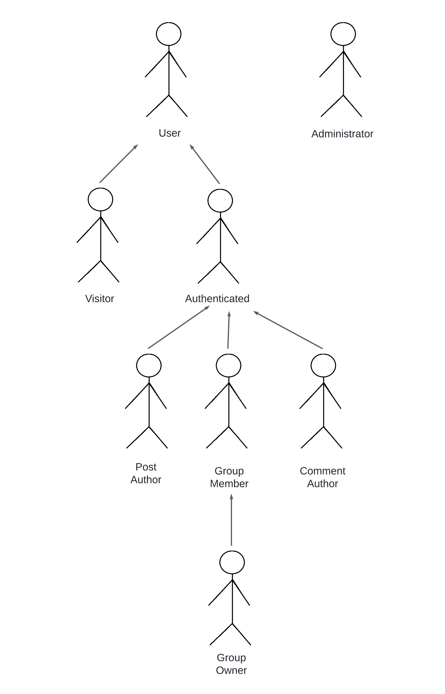

# LBAW

# ER: Requirements Specification Component

> Project vision.

## A1 - ConnectFEUP

### Context 

Making real connections with fellow students can be a challenge, especially at a large university like FEUP. Whether it's romantic interests or establishing new friendships, students can find it difficult to find like-minded people. This project aims to help even the most introverted to create unique and true relationships. 

### Motivation

The motivation to carry out this project comes from a need to create a platform where FEUP students can find friends, love, in a safe and trustworthy space. This social network could help even the shyest students to socialize and possibly find their dream partner. 

### Objectives

The main objective of this project is to facilitate meaningful connections among students from the same faculty, whether personal, romantic, or professional. A key priority is ensuring that only verified FEUP students can access the platform, safeguarding personal data and privacy. The platform will feature an intuitive, user-friendly interface, incorporating Tinder-like functionality, and will be fully compatible across all devices.

### Main features

**User**

- Registration
- Sign in/out
- Recover password
- View a public profile
- Edit profile
- Delete account

**Authenticated User**

- View profile
- Edit profile
- Change profile picture
- View personal notifications
- View personalized timeline
- Search for posts, comments, groups and users
- Search filters
- Send friend requests
- View friend profiles
- Manage incoming friend requests
- Manage friends
- Create a post
- Comment on posts
- Like posts
- Reply to comments
- Create groups
- View users' feeds
- Join a public group
- Manage notifications
- Tag friends in posts
- View friends' feeds
- Ask to join public groups

**Author of the post**

- Edit post
- Delete post
- Manage post visibility

**Comment author:**

- Edit comment
- Delete comment

**Group member:**

- View group members
- Post in the group
- Leave the group

**Group owner:**

- Edit group information
- Remove member
- Invite to the group
- Remove post from group
- Change group visibility
- Manage group invitations
- Manage membership requests

**Notifications
- Like your own post
- Comments on your own post
- Friend request

**Administrator:**
- Administer user accounts
- Lock and unlock user accounts
- Delete user accounts

**Help:**

- Bookmarks for form entries
- Contextual error messages
- Contextual help

**Information about the site**
- About us
- Main features
- Contact

## A2: Actors and User stories

The _actors_ and _user stories_ contain information about the people who will use ConnectFEUP and how to use it.  

### 1. Actors

In the figure below, you can see the representation of the actors

Below, you can see the description of each actor

| Identifier              | Name      |                                     
| ----------------------- | --------- | 
|  Administrator          | Administrator The administrator has the power to remove messages, block and unblock people. |
|  User                   | Normal User. |
|  Guest                  | Unauthenticated users can view public information, register or log in. |
|  Autenticated User      | Authenticated users can view information, comment on other people's posts, send and receive messages with other people or groups. |
|  Group Member           | Members of a group can participate, chat and post in a group, but do not have special permissions. |
|  Group Owner            | Group owners not only have the same permissions as a member, but can also edit the group name, description, add/remove members and edit the permissions of other participants. |
|  Post Author            | Users can delete or edit their post. |
|  Comment Author         | Users can edit or delete their own comments on any post. |

### 2. User Stories

> User stories organized by actor.  
> For each actor, a table containing a line for each user story, and for each user story: an identifier, a name, a priority, and a description (following the recommended pattern).
> Below is a template for presenting the user stories.

#### 2.1. Administrador 1

- **Administrator**: Manages user accounts, blocks or unblocks users, and ensures safe platform use.

| Identifier   | Name      | Priority    | Description                                           |
| ------------ | --------- | ----------- | ----------------------------------------------------- |
|  US01        | US Name 1 | High        | As an \<actor\>, I want to \<what\>, so that \<why\>. |
|  US02        | US Name 2 | Medium      | As an \<actor\>, I want to \<what\>, so that \<why\>. |
|  US03        | US Name 3 | Low         | As an \<actor\>, I want to \<what\>, so that \<why\>. |

#### 2.2. Utilizador

- **User**: Manages personal profile information and account settings.

| Identifier   | Name      | Priority    | Description                                           |
| ------------ | --------- | ----------- | ----------------------------------------------------- |
|  US01        | US Name 1 | High        | As an \<actor\>, I want to \<what\>, so that \<why\>. |
|  US02        | US Name 2 | Medium      | As an \<actor\>, I want to \<what\>, so that \<why\>. |
|  US03        | US Name 3 | Low         | As an \<actor\>, I want to \<what\>, so that \<why\>. |

### 2.3 Visitante

- **Visitor**: Browses public information, registers, and logs in.

| Identifier   | Name      | Priority    | Description                                           |
| ------------ | --------- | ----------- | ----------------------------------------------------- |
|  US01        | US Name 1 | High        | As an \<actor\>, I want to \<what\>, so that \<why\>. |
|  US02        | US Name 2 | Medium      | As an \<actor\>, I want to \<what\>, so that \<why\>. |
|  US03        | US Name 3 | Low         | As an \<actor\>, I want to \<what\>, so that \<why\>. |

#### 2.4. Autenticado

- **Authenticated User**: Has access to features like posting, commenting, managing friends, and joining groups.

| Identifier   | Name      | Priority    | Description                                           |
| ------------ | --------- | ----------- | ----------------------------------------------------- |
|  US01        | US Name 1 | High        | As an \<actor\>, I want to \<what\>, so that \<why\>. |
|  US02        | US Name 2 | Medium      | As an \<actor\>, I want to \<what\>, so that \<why\>. |
|  US03        | US Name 3 | Low         | As an \<actor\>, I want to \<what\>, so that \<why\>. |

### 2.5 Membro do grupo

- **Group Member**: Interacts within groups by posting and engaging with other group members.

| Identifier   | Name      | Priority    | Description                                           |
| ------------ | --------- | ----------- | ----------------------------------------------------- |
|  US01        | US Name 1 | High        | As an \<actor\>, I want to \<what\>, so that \<why\>. |
|  US02        | US Name 2 | Medium      | As an \<actor\>, I want to \<what\>, so that \<why\>. |
|  US03        | US Name 3 | Low         | As an \<actor\>, I want to \<what\>, so that \<why\>. |

### 2.6 Proprietário do grupo

- **Group Owner**: Manages group settings and membership, controls group visibility.

| Identifier   | Name      | Priority    | Description                                           |
| ------------ | --------- | ----------- | ----------------------------------------------------- |
|  US01        | US Name 1 | High        | As an \<actor\>, I want to \<what\>, so that \<why\>. |
|  US02        | US Name 2 | Medium      | As an \<actor\>, I want to \<what\>, so that \<why\>. |
|  US03        | US Name 3 | Low         | As an \<actor\>, I want to \<what\>, so that \<why\>. |

### 2.7 Autor da publicação

- **Post Author**: Edits or deletes their own posts.

| Identifier   | Name      | Priority    | Description                                           |
| ------------ | --------- | ----------- | ----------------------------------------------------- |
|  US01        | US Name 1 | High        | As an \<actor\>, I want to \<what\>, so that \<why\>. |
|  US02        | US Name 2 | Medium      | As an \<actor\>, I want to \<what\>, so that \<why\>. |
|  US03        | US Name 3 | Low         | As an \<actor\>, I want to \<what\>, so that \<why\>. |

### 2.8 Autor do comentário

- **Comment Author**: Edits or deletes their own comments.

| Identifier   | Name      | Priority    | Description                                           |
| ------------ | --------- | ----------- | ----------------------------------------------------- |
|  US01        | US Name 1 | High        | As an \<actor\>, I want to \<what\>, so that \<why\>. |
|  US02        | US Name 2 | Medium      | As an \<actor\>, I want to \<what\>, so that \<why\>. |
|  US03        | US Name 3 | Low         | As an \<actor\>, I want to \<what\>, so that \<why\>. |

### 3. Supplementary Requirements

> Section including business rules, technical requirements, and restrictions.  
> For each subsection, a table containing identifiers, names, and descriptions for each requirement.

#### 3.1. Business rules

#### 3.2. Technical requirements

#### 3.3. Restrictions

---

## A3: Information Architecture

> Brief presentation of the artifact goals.

### 1. Sitemap

> Sitemap presenting the overall structure of the web application.  
> Each page must be identified in the sitemap.  
> Multiple instances of the same page (e.g. student profile in SIGARRA) are presented as page stacks.

### 2. Wireframes

> Wireframes for, at least, two main pages of the web application.
> Do not include trivial use cases (e.g. about page, contacts).

#### UIxx: Page Name

#### UIxx: Page Name

---

## Revision history

Changes made to the first submission:
1. Item 1
1. ...

***
GROUP24116, 01/10/2024

* Alexandre Chouzende - 202207429@up.pt
* Rui Borges - 202207475@up.pt
* Pedro Paixão- 202008467@up.pt
* Tiago Torrado - 202206399@up.pt